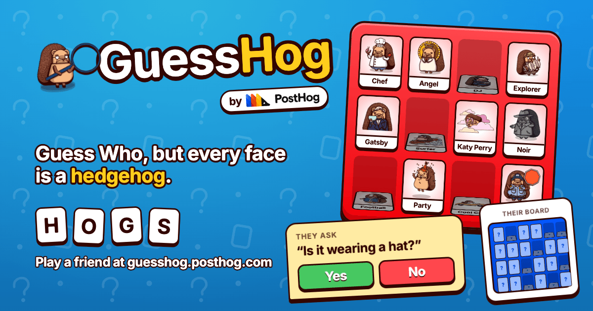

# GuessHog

[](https://guesshog.posthog.com)

**Guess Who, but every face is a PostHog hedgehog.** Play it at **[guesshog.posthog.com](https://guesshog.posthog.com)**.

Create a room, send the four-letter code to a friend, and take a seat. Each player gets a secret hoggie from a board of 24. Take turns asking yes-or-no questions, flip down the hogs it can't be, and guess theirs before they guess yours. Everyone else in the room watches from the stands and sees both boards and both secrets.

## How it works

```
Browser ──WebSocket──▶ Worker (/api/*) ──▶ GameRoom Durable Object (one per room code)
   ▲                                          • owns the room state, persisted to SQLite storage
   └── React SPA, served as static assets     • sends each person their own view of the game
       by the same Worker                     • hibernates when idle, deleted after 1h empty
```

- **`worker/`**: the Worker and the `GameRoom` Durable Object. `game.ts` holds the rules as pure functions (and is where the tests live). `viewFor` decides what each person sees: players only see their own secret (and the backs of their opponent's board), spectators see everything.
- **`shared/protocol.ts`**: the typed messages that go over the WebSocket, shared by client and server.
- **`src/`**: the React app.
- **`index.html`**: all the metadata: Open Graph and Twitter cards, JSON-LD (the game as a `VideoGame`, how to play as a `HowTo`, PostHog as the `Organization`), and a plain-HTML summary in `<noscript>` for crawlers that don't run JavaScript. Invite links (`/r/CODE`) go through the worker, which rewrites the title and description so they unfurl as an invitation and marks them `noindex`.
- **`public/`**: the social card (`og.png`), icons, web manifest, `robots.txt`, `sitemap.xml`, and `llms.txt`. The card and icons are generated by `pnpm gen:social` (see `scripts/gen-social-assets.mjs`, which screenshots `scripts/social/og.html` in headless Chrome) and committed.
- **`scripts/sync-hoggies.mjs`**: builds the deck from [`@posthog/brand`](https://github.com/PostHog/brand). Every hoggie tagged `solo` (and not `group`) becomes a card; the script writes `shared/hoggies.json` and resized WebPs to `public/hoggies/`. Both are generated, so they're gitignored.

Hoggies, colours and the RoundHog typeface all come from `@posthog/brand`. It's pinned to an exact version because exports can change in minor releases before 1.0.

## Development

```sh
pnpm install
pnpm dev        # Vite + the Worker and Durable Object running locally in workerd
pnpm test       # game rules
pnpm typecheck
```

Open two browser windows (or one normal and one private) to play against yourself.

## Deploying

```sh
pnpm run deploy
```

This builds the app and runs `wrangler deploy`, which serves the Worker on the `guesshog.posthog.com` custom domain (see `wrangler.jsonc`). To pick up new hoggies, bump `@posthog/brand` in `package.json` and redeploy.
